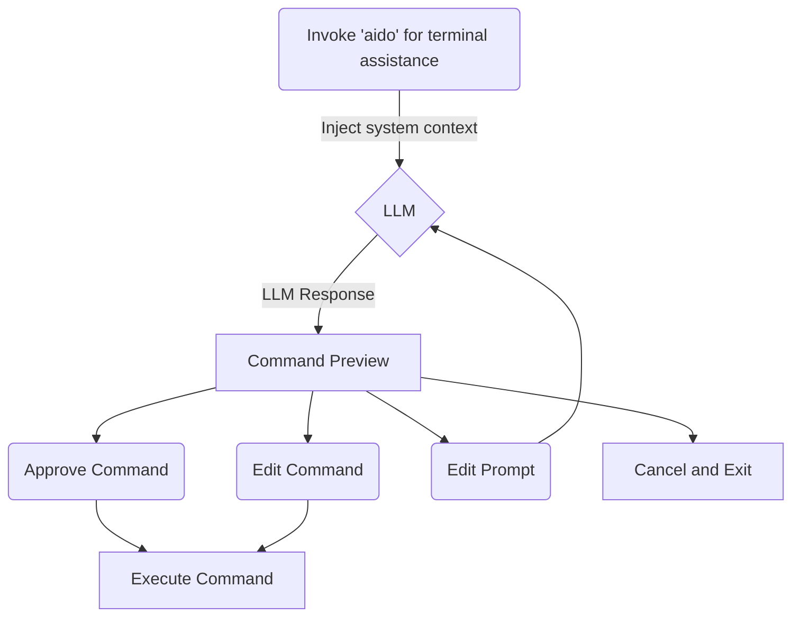

# aido

`aido` is a local-first, transparent natural-language → shell-command helper.
Perfect for when you can't remember the right command or if you're learning.
It asks an Ollama model for a single command, shows it to you, and enters an
interactive approve/edit/cancel loop.



## Features

- **Local & private** — talks to your own [Ollama](https://ollama.com) server.
- **Never auto-executes** — you preview every command and approve before it runs.
- **Interactive loop** — approve, edit the command, refine the prompt, or cancel.
- **Configurable** — model, host, temperature and editor via a small config file.
- **Dry-run** — preview a generated command without the interactive loop.
- **Command history** — every run is logged to `~/.aido/history.jsonl`.

## Install

Requires: `bash`, `curl`, `jq` (and [Ollama](https://ollama.com) running).

```bash
./scripts/install.sh          # installs to ~/.local (no root needed)
```

Options:

| Flag          | Description                                            |
| ------------- | ------------------------------------------------------ |
| `--dry-run`   | Show what would be installed without installing        |
| `--prefix P`  | Install to `P/bin` and `P/lib` (default `~/.local`)    |
| `--force`     | Overwrite an existing install                          |
| `--uninstall` | Remove aido's files (keeps your command history)       |
| `--sudo`      | Install to a system path (e.g. `/usr/local`) with sudo |

> After `~/.local` installs, make sure `~/.local/bin` is on your `PATH`:
>
> ```bash
> export PATH="$HOME/.local/bin:$PATH"
> ```
