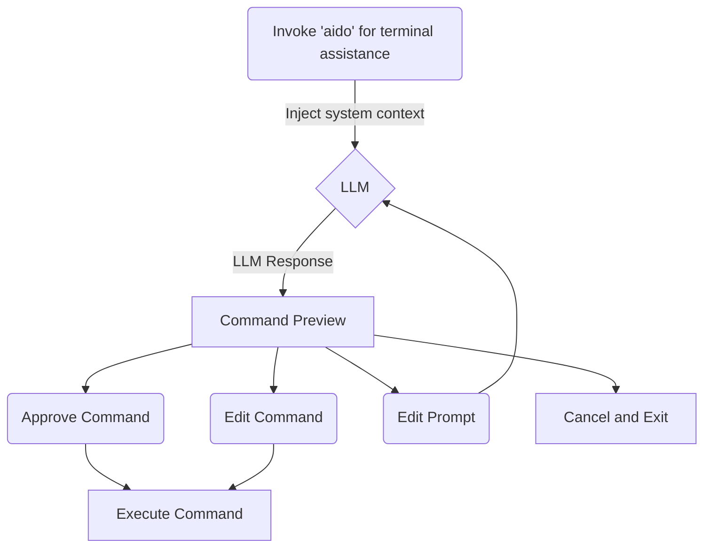

# aido

`aido` is a local-first, transparent natural-language → shell-command helper.
Perfect for when you can't remember the right command or if you're learning.
It asks an Ollama model for a single command, shows it to you, and enters an
interactive approve/edit/cancel loop.



## Features

- **Local & private** — talks to your own [Ollama](https://ollama.com) server.
- **Never auto-executes** — you preview every command and approve before it runs.
- **Interactive loop** — approve, edit the command, refine the prompt, or cancel.
- **Configurable** — model, host, temperature and editor via a small config file.
- **Dry-run** — preview a generated command without the interactive loop.
- **Command history** — every run is logged to `~/.aido/history.jsonl`.

## Install

Requires: `bash`, `curl`, `jq` (and [Ollama](https://ollama.com) running).

```bash
./scripts/install.sh          # installs to ~/.local (no root needed)
```

Options:

| Flag          | Description                                            |
| ------------- | ------------------------------------------------------ |
| `--dry-run`   | Show what would be installed without installing        |
| `--prefix P`  | Install to `P/bin` and `P/lib` (default `~/.local`)    |
| `--force`     | Overwrite an existing install                          |
| `--uninstall` | Remove aido's files (keeps your command history)       |
| `--sudo`      | Install to a system path (e.g. `/usr/local`) with sudo |

> After `~/.local` installs, make sure `~/.local/bin` is on your `PATH`:
>
> ```bash
> export PATH="$HOME/.local/bin:$PATH"
> ```

## Usage

```bash
aido "find all .mjs files and replace LLMService with LLMServices"
aido "show disk usage of the largest directories in the current folder"
aido "create a python virtualenv and install requests"

aido --dry-run "list the three largest files in the current directory"
aido --config          # edit the user config
```

After a command is generated you're prompted:

```
[a]pprove  [e]dit command  [p]rompt again  [c]ancel
```

## Configuration

Persistent settings live at:

```
~/.config/aido/config.env
```

`--config` opens it in `$EDITOR` on first run (a template is created
automatically). Format is `KEY=value`, one per line, `#` for comments:

```sh
# aido user config (~/.config/aido/config.env)
MODEL=qwen2.5-coder:7b
OLLAMA_HOST=http://localhost:11434
TEMPERATURE=0.1
EDITOR=vim
MAX_RETRIES=2
```

### Precedence

Configuration is resolved highest-to-lowest priority:

1. **Explicit environment variables** — `AIDO_MODEL=...`, `OLLAMA_HOST=...`,
   `AIDO_TEMPERATURE=...`, `EDITOR=...`, `HISTORY_FILE=...`, `MAX_RETRIES=...`
2. **The config file** — `~/.config/aido/config.env`
3. **Built-in defaults** — `qwen2.5-coder:7b`, `http://localhost:11434`,
   `0.1`, `nano`, `~/.aido/history.jsonl`, `2`

A value set to blank in the config file falls back to the default.

### Environment variables

| Variable            | Default                     | Description                       |
| ------------------- | --------------------------- | --------------------------------- |
| `AIDO_MODEL`        | `qwen2.5-coder:7b`          | Ollama model                      |
| `OLLAMA_HOST`       | `http://localhost:11434`    | Ollama API URL                    |
| `AIDO_TEMPERATURE`  | `0.1`                       | Sampling temperature (0–1)        |
| `EDITOR`            | `nano`                      | Editor for edit/config actions    |
| `HISTORY_FILE`      | `~/.aido/history.jsonl`     | Where command history is logged   |
| `MAX_RETRIES`       | `2`                         | Max prompt-refine cycles          |

## Development

```bash
bash test/run_tests.sh   # offline unit tests (uses test/mock_ollama.sh)
```

## Layout

```
aido/
├── src/bin/aido         # thin entry point
├── src/lib/
│   ├── config.sh        # config loading & validation
│   ├── context.sh       # gather environment context for the system prompt
│   ├── llm.sh           # Ollama caller
│   ├── prompt.sh        # build the system prompt
│   ├── ui.sh            # interactive approval loop + editor helper
│   └── util.sh          # shared helpers (die/info/history logging)
├── scripts/install.sh   # user-installable installer
├── test/                # offline test harness + Ollama mock
└── PLAN.md
```
