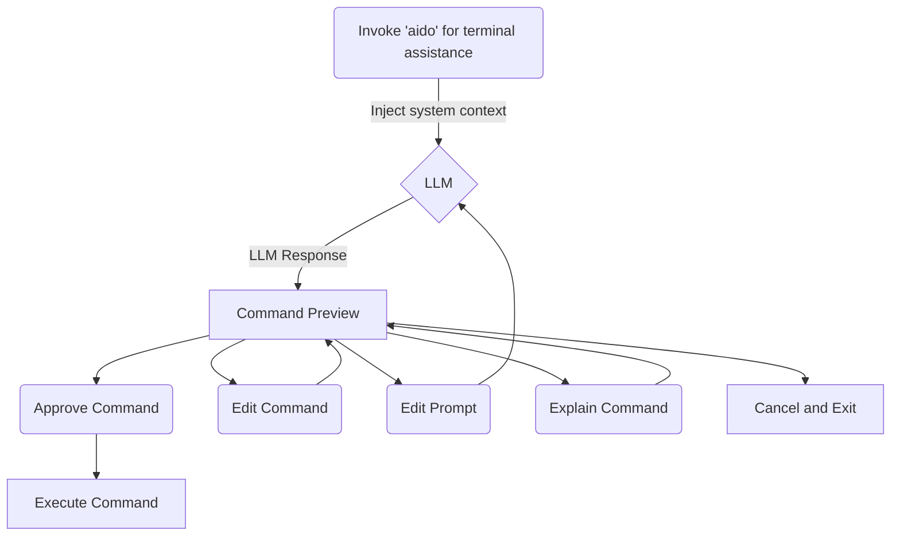

# aido

`aido` is a local-first, transparent natural-language → shell-command helper.
Perfect for when you can't remember the right command or if you're learning.
It asks an LLM (via any OpenAI-compatible endpoint) for a single command, shows it to you, and enters an
interactive approve/edit/explain/cancel loop.

## Screencap

Screencap shows an install and command execution + edit loop on local ollama running off CPU.


## Flowchart



## Features

- **Local & private by default** — talks to your own [Ollama](https://ollama.com) server (or any OpenAI-compatible endpoint).
- **Never auto-executes** — you preview every command and approve before it runs.
- **Interactive loop** — approve, edit the command, explain, refine the prompt, or cancel.
- **Configurable** — model, base URL, temperature and editor via a small config file.
- **Dry-run** — preview a generated command without the interactive loop.
- **Command history** — every run is logged to `~/.aido/history.jsonl`.
- **Light TUI** — ANSI framing by default; automatically uses `gum` or `dialog` when available.

## Quickstart

Get aido running in a few steps. Everything below assumes you're on Linux/macOS with [Docker](https://docs.docker.com/get-started/) installed.

**1. Start an Ollama server** (runs locally, your prompts never leave your machine):

```bash
docker pull ollama/ollama
docker run -d -v ollama:/root/.ollama -p 11434:11434 --name ollama ollama/ollama
```

**2. Pull the default model** (`qwen2.5-coder:7b`). The server lives inside the container on the same port:

```bash
docker exec -it ollama ollama pull qwen2.5-coder:7b
```

**3. Install aido** (to `~/.local`, no root needed):

```bash
./scripts/install.sh
export PATH="$HOME/.local/bin:$PATH"   # so `aido` is on your PATH
```

**4. Try it out:**

```bash
aido list the three largest files in the current directory
```

See [`docs/USAGE.md`](docs/USAGE.md) for the full command loop, and [`docs/CONFIGURATION.md`](docs/CONFIGURATION.md) for tuning model, base URL, temperature and more.

## Install

Requires: `bash`, `curl`, `jq` (and an OpenAI-compatible LLM server such as [Ollama](https://ollama.com) running).

```bash
./scripts/install.sh          # installs to ~/.local (no root needed)
```
